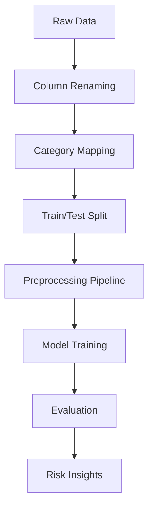

# Credit Risk Analysis & Prediction

I built this to predict loan default risk using historical data from the UCI South German Credit dataset.

[](https://opensource.org/licenses/MIT)
[](https://www.python.org/)
[](https://scikit-learn.org/)

## Why I built this
I wanted to know if basic categorical data—like account status and credit history—could reliably flag risky loans. I used this dataset to practice building a clean pipeline from raw, coded data to a model that provides a clear risk score.

## What it does
The project takes raw credit records and transforms them into a predictive model. It maps numeric codes to readable labels, handles preprocessing via scikit-learn pipelines, and compares three different classifiers to find the best balance between precision and recall.



## Data
I used the UCI South German Credit dataset. It contains 1,000 records of loan applicants from the mid-1970s. The target is whether the credit was "good" or "bad."

## Stack
| Tool | Use |
| :--- | :--- |
| Python | Language |
| pandas | Data manipulation |
| scikit-learn | Preprocessing & Modeling |
| matplotlib / seaborn | Visualization |
| pytest | Logic validation |

## Project Structure
```text
credit-risk-analysis/
├── data/                # Raw source files
├── images/              # Analysis plots
├── notebooks/           # Full research walk-through
├── src/
│   └── credit_risk/     # Core logic
│       ├── constants.py # Mapping tables
│       └── processing.py# Cleaning functions
├── tests/               # Unit tests for logic
└── pyproject.toml       # Project config
```

## Run it locally
1. Clone the repo.
2. Install dependencies:
   ```bash
   pip install .[dev]
   ```
3. Run the tests:
   ```bash
   pytest
   ```
4. Open `notebooks/credit_risk_analysis.ipynb` to see the full analysis.

## Key Results
Based on a held-out test set of 200 records:

| Model | Accuracy | Recall | ROC-AUC |
| :--- | :---: | :---: | :---: |
| **Random Forest** | **0.770** | 0.333 | **0.755** |
| Logistic Regression | 0.740 | 0.433 | 0.742 |
| Decision Tree | 0.735 | 0.267 | 0.689 |

**Risk Drivers:**
- Applicants with accounts "Below 0 DM" had a 39.0% bad credit rate.
- Loans longer than 24 months had a 44.3% bad credit rate.
- The overall sample bad credit rate is 30.0% (due to oversampling).

## What I learned
- **Target Distribution:** I saw how deliberate oversampling in a dataset changes the baseline risk rate.
- **Metric Choice:** I learned why recall matters more than accuracy when the cost of missing a bad loan is high.
- **Feature Influence:** I found that checking account status is one of the strongest indicators of risk.
- **Pipeline Utility:** I used scikit-learn pipelines to prevent data leakage between training and testing.
- **Interpretability:** I used logistic regression coefficients to explain why certain applicants were flagged as risky.

## Limitations
- **Old Data:** The records are from 1973–1975 and may not reflect modern credit behavior.
- **Small Sample:** 1,000 records is a small set for machine learning.
- **Missing Data:** There is no income variable in the source data.

## Roadmap
- [ ] Try gradient boosting models like XGBoost.
- [ ] Implement K-fold cross-validation.
- [ ] Create a simple CLI tool to score a new applicant.

## License
MIT

## Contact
Ahmed Sameh - [github.com/ahmed-sameh](https://github.com/ahmed-sameh)
