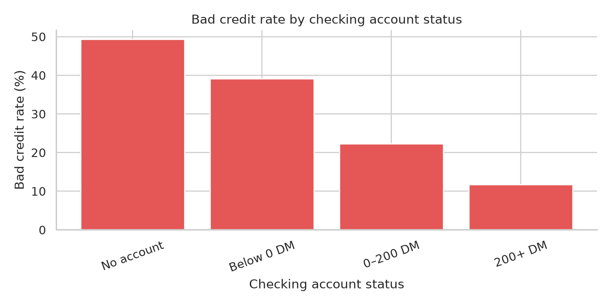
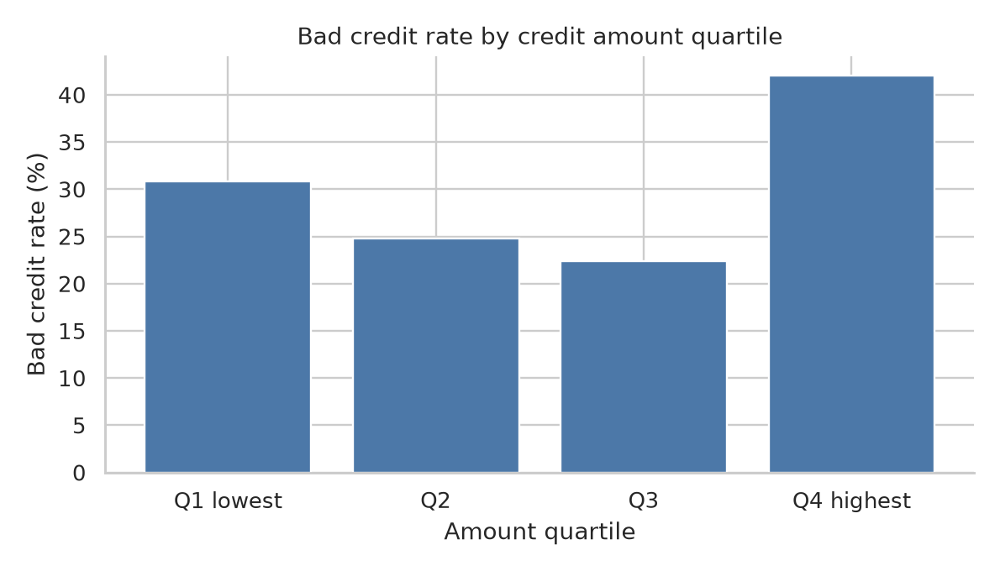
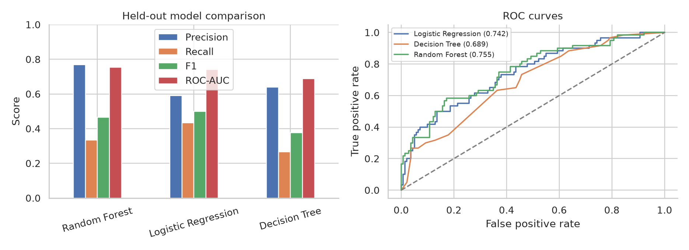

# Credit Risk Analysis & Prediction

An exploratory analysis and small machine learning comparison using historical credit records. The project asks whether recorded customer and credit information helps identify bad credit outcomes and which features are associated with greater risk.

## Overview

The notebook checks data quality, explores outcome patterns, and compares three classifiers on one held-out test set. A bad credit outcome is the positive class. The models are illustrative benchmarks, not lending decision systems.

## Dataset

[South German Credit](https://archive.ics.uci.edu/dataset/573/south+german+credit+update) from the UCI Machine Learning Repository, [CC BY 4.0](https://creativecommons.org/licenses/by/4.0/). The repository includes the original `SouthGermanCredit.asc` and `codetable.txt` files. The source describes 1,000 records from 1973–1975, 20 predictors, and a credit outcome (`0 = bad`, `1 = good`). It states that bad credits were deliberately oversampled. The source also notes that credit amounts in DM were transformed, with the original transformation unknown.

This sample has 700 good and 300 bad outcomes. It contains no income variable. Its 30% bad-outcome rate should not be treated as a current population rate.

## Project Workflow

1. Inspect dimensions, types, missing values, duplicates, category codes, and target balance.
2. Rename fields and map coded categories using the original code table. No rows are removed.
3. Explore risk across credit amount, duration, checking status, savings, housing, and age.
4. Split the data 80/20 with stratification, then fit imputation, one-hot encoding, and scaling within each training pipeline.
5. Compare Logistic Regression, Decision Tree, and Random Forest on the untouched test set.

## Exploratory Analysis





The notebook contains additional age, credit amount, duration, category, and correlation charts. Category rates are descriptive associations, not causal estimates.

## Model Results

Held-out test set: 200 records, including 60 bad outcomes. Scores below are rounded to three decimals; the classification threshold is 0.5.

| Model | Accuracy | Precision | Recall | F1 | ROC-AUC |
| --- | ---: | ---: | ---: | ---: | ---: |
| Random Forest | 0.770 | 0.769 | 0.333 | 0.465 | 0.755 |
| Logistic Regression | 0.740 | 0.591 | 0.433 | 0.500 | 0.742 |
| Decision Tree | 0.735 | 0.640 | 0.267 | 0.376 | 0.689 |

Random Forest has the highest ROC-AUC. At the chosen threshold it catches 20 of 60 bad outcomes, so its recall is limited. Logistic Regression has the highest recall and F1 in this comparison. Precision matters because false alarms create unnecessary reviews; recall matters because missed bad outcomes may be costly. ROC-AUC compares ranking across thresholds.



## Key Insights

- Checking accounts below 0 DM had a 39.0% bad-outcome rate, compared with 11.7% for accounts at 200+ DM.
- Credits longer than 24 months had a 44.3% bad-outcome rate, compared with 25.7% for shorter credits.
- Above-median credit amounts had a 32.2% bad-outcome rate, compared with 27.8% for the lower half.
- Logistic Regression coefficients also indicate associations, but they are conditional on the other included features and do not establish causation.

The records are small, old, and deliberately oversampled. A predictive score should support risk assessment and human review, not automatically determine real-world lending decisions. A practical system would need current representative data, calibration, and fairness review.

## Project Structure

```text
credit-risk-analysis/
├── data/raw/                 # UCI data and code table
├── notebooks/credit_risk_analysis.ipynb
├── images/                   # Charts saved by the notebook
├── portfolio/                # Three result-based portfolio images
├── requirements.txt
└── README.md
```

## Technologies

Python, pandas, NumPy, Matplotlib, Seaborn, scikit-learn, Jupyter Notebook.

## How to Run

From the repository root:

```bash
python -m venv .venv
source .venv/bin/activate
python -m pip install -r requirements.txt
cd notebooks
jupyter nbconvert --to notebook --execute --inplace credit_risk_analysis.ipynb
```

The notebook reads `../data/raw/SouthGermanCredit.asc` and saves charts in `images/` and summaries in `portfolio/`.

## Author

Ahmed Sameh
