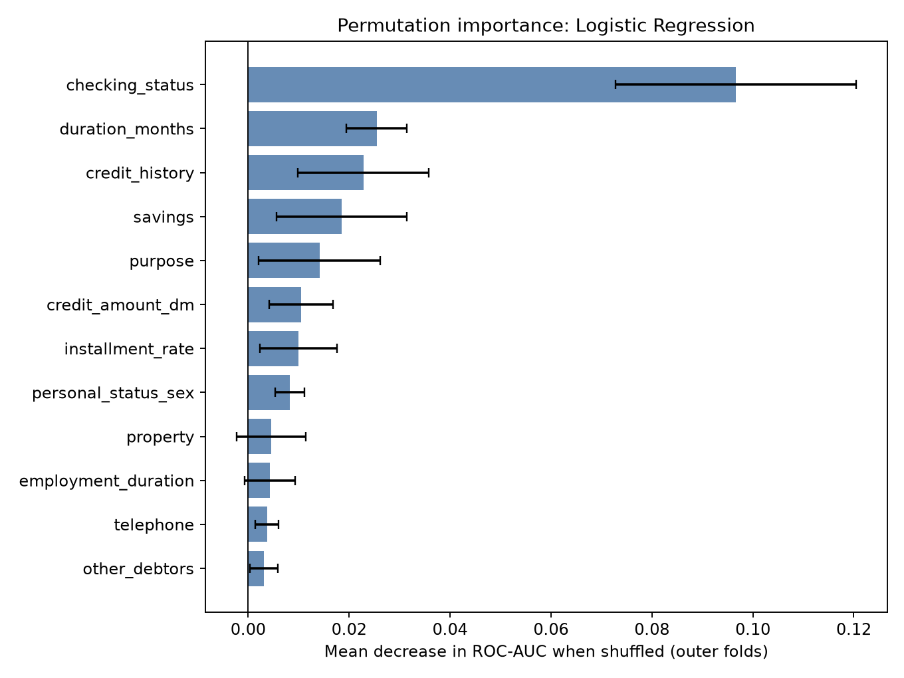

# Credit Risk Analysis

I used a small historical credit dataset to look at which applicant and loan
attributes are associated with bad outcomes, and to compare several simple
classifiers. This is a learning project, not a lending decision system.

**The data**

The UCI South German Credit data: 1,000 loans from 1973-1975, 20 predictors,
and a good/bad outcome (700 good, 300 bad). Bad credits were deliberately
oversampled, so the 30% bad rate is not a population rate. Credit amounts were
transformed in the original source with an unpublished method, and there is no
income field.

**What I did**

- Checked category codes against `codetable.txt` before mapping, so unexpected
  codes fail loudly instead of passing through silently.
- Kept outliers, since large loans and long durations are plausible.
- Put imputation, one-hot encoding, and scaling inside every model pipeline.
  Class weights also live inside the pipeline, so nothing is fitted outside the
  training fold.
- Compared logistic regression, a decision tree, a random forest, and
  `HistGradientBoosting`, each with and without `class_weight="balanced"`.
- Used nested cross-validation: 5 outer stratified folds on the 800 training
  rows, with 3-fold `RandomizedSearchCV` (20 candidates) inside each outer fold.
  All random states are 42.
- Chose the decision threshold on inner out-of-fold predictions, minimising the
  German Credit cost matrix: a bad applicant predicted good costs 5, a false
  alarm costs 1.
- Left the 200-row test set untouched until one final check. No hyperparameter
  or threshold was tuned on it.

**What stood out**

Checking account status separates outcomes most clearly: records with no
checking account had a 49.3% bad rate, while accounts at 200+ DM had 11.7%.
Contracts longer than 24 months had a 44.3% bad rate versus 25.7% for shorter
ones, and the highest credit-amount quartile reached 42.0%. These are
associations in this sample, not causal effects.

**Results**

Nested cross-validation on the 800 training rows, mean +/- standard deviation
across 5 outer folds. Each outer test fold contains 160 applicants. Cost is the
total per fold; lower is better.

| Model | ROC-AUC | Recall @0.5 | Recall @tuned | Cost @tuned | Threshold |
| --- | ---: | ---: | ---: | ---: | ---: |
| Logistic Regression | 0.778 +/- 0.039 | 0.420 +/- 0.062 | 0.890 +/- 0.069 | 111.0 +/- 15.2 | 0.176 +/- 0.056 |
| HistGradientBoosting (balanced) | 0.773 +/- 0.035 | 0.597 +/- 0.040 | 0.883 +/- 0.103 | 111.2 +/- 20.5 | 0.108 +/- 0.084 |
| Random Forest | 0.781 +/- 0.055 | 0.207 +/- 0.086 | 0.907 +/- 0.048 | 112.0 +/- 18.8 | 0.214 +/- 0.026 |
| HistGradientBoosting | 0.779 +/- 0.033 | 0.467 +/- 0.095 | 0.883 +/- 0.061 | 112.6 +/- 14.0 | 0.090 +/- 0.068 |
| Random Forest (balanced) | 0.785 +/- 0.052 | 0.677 +/- 0.100 | 0.900 +/- 0.059 | 113.0 +/- 13.9 | 0.338 +/- 0.056 |
| Logistic Regression (balanced) | 0.781 +/- 0.043 | 0.697 +/- 0.057 | 0.873 +/- 0.088 | 113.2 +/- 20.1 | 0.338 +/- 0.049 |
| Decision Tree (balanced) | 0.701 +/- 0.030 | 0.803 +/- 0.068 | 0.877 +/- 0.022 | 123.0 +/- 11.1 | 0.264 +/- 0.129 |
| Decision Tree | 0.681 +/- 0.033 | 0.187 +/- 0.097 | 0.877 +/- 0.048 | 131.2 +/- 7.8 | 0.122 +/- 0.058 |

The six strongest models land between 111 and 113 cost units, well inside one
standard deviation of each other. I would not claim a winner. Logistic
regression has the lowest mean cost, but the gap to the random forest and
gradient boosting is not meaningful at this sample size.

At the default 0.5 threshold, recall for the bad class is poor for the
unweighted tree models. Tuning the threshold for the 5:1 cost raises recall to
roughly 0.87-0.91 for every model, at the cost of lower precision. The useful
lever here is the threshold, not the classifier.

Gradient boosting did not improve on logistic regression: `HistGradientBoosting`
had ROC-AUC 0.779 +/- 0.033 and cost 112.6 +/- 14.0, against 0.778 +/- 0.039 and
111.0 +/- 15.2 for logistic regression. The balanced variant was also within
noise. I kept the simpler model.

Class-weight effect, reported as balanced minus base (mean +/- std across the
same outer folds; negative cost means lower cost):

| Family | Recall @0.5 | Recall @tuned | Cost @tuned |
| --- | ---: | ---: | ---: |
| Decision Tree | +0.617 +/- 0.124 | +0.000 +/- 0.033 | -8.2 +/- 8.8 |
| Random Forest | +0.470 +/- 0.144 | -0.007 +/- 0.049 | +1.0 +/- 7.0 |
| Logistic Regression | +0.277 +/- 0.055 | -0.017 +/- 0.067 | +2.2 +/- 13.6 |
| HistGradientBoosting | +0.130 +/- 0.087 | +0.000 +/- 0.077 | -1.4 +/- 13.8 |

Balanced weights do what they are supposed to at a fixed 0.5 threshold: recall
for the bad class rises by 0.13 to 0.62, while precision falls by 0.03 to 0.22.
Once the threshold is tuned for cost, the recall advantage disappears, and
every cost change is within one standard deviation. On this dataset, class
weights mostly move the operating point that threshold tuning already controls.

**Final check on the untouched test set**

I fitted the selected family (logistic regression) on the 800 training rows,
chose its threshold from inner out-of-fold predictions, and evaluated the
200-row test set once:

| ROC-AUC | Recall @0.5 | Recall @0.27 | Cost @0.5 | Cost @0.27 |
| ---: | ---: | ---: | ---: | ---: |
| 0.752 | 0.417 | 0.733 | 187 | 132 |

The cost-based threshold reduced total cost from 187 to 132 (about 29%) on the
same 200 applicants, while recall rose from 0.417 to 0.733. This is a single
check, not a second tuning round.

**Feature importance**



Permutation importance for the selected model, averaged over the outer test
folds (mean decrease in ROC-AUC when a feature is shuffled): checking status
0.097, duration 0.025, credit history 0.023, savings 0.019, purpose 0.014,
credit amount 0.011. Checking status dominates. Correlated features share
credit, so these values describe predictive contribution rather than isolated
causes.

**Limitations**

- The sample is small, old, and deliberately oversampled; it is not
  representative of a current population.
- There is no income variable, and the amount transformation is undocumented.
- Fold-to-fold spread is wide, and differences among the top models are small
  relative to that spread.
- The 5:1 cost matrix is an assumption, not a measured business cost.
- No probability calibration, fairness audit, or SHAP analysis.
- Permutation importance is affected by correlated predictors.

**Run it**

```bash
python -m venv .venv
source .venv/bin/activate
pip install -r requirements.txt
python src/nested_cv.py
```

`src/cross_validation.py` runs the simpler 5-fold comparison without tuning.
The notebook contains the cleaning, exploratory analysis, original single-split
comparison, threshold table, and figures:

```bash
cd notebooks
jupyter nbconvert --to notebook --execute --inplace credit_risk_analysis.ipynb
```

The nested run writes per-fold and summary results, the class-weight comparison,
the final test check, and feature importances under `reports/`, plus
`images/feature_importance.png`.

**Files**

- `notebooks/credit_risk_analysis.ipynb` - full analysis and figures
- `src/nested_cv.py` - nested CV, cost-based thresholds, importance
- `src/cross_validation.py` - simple 5-fold comparison
- `data/raw/` - source data and category code table
- `reports/` - model outputs
- `images/`, `portfolio/` - charts
