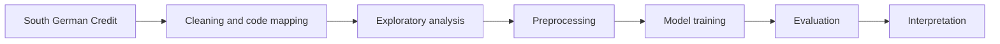
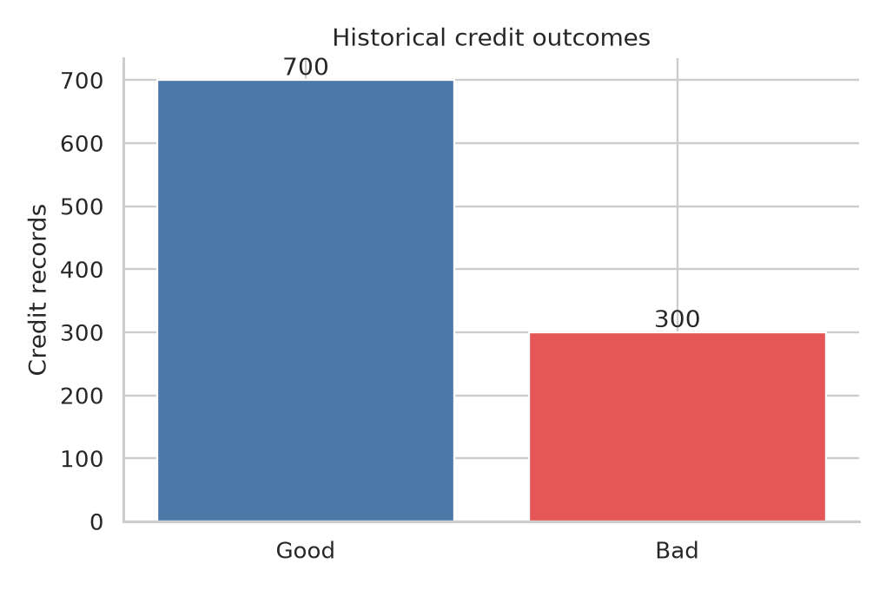
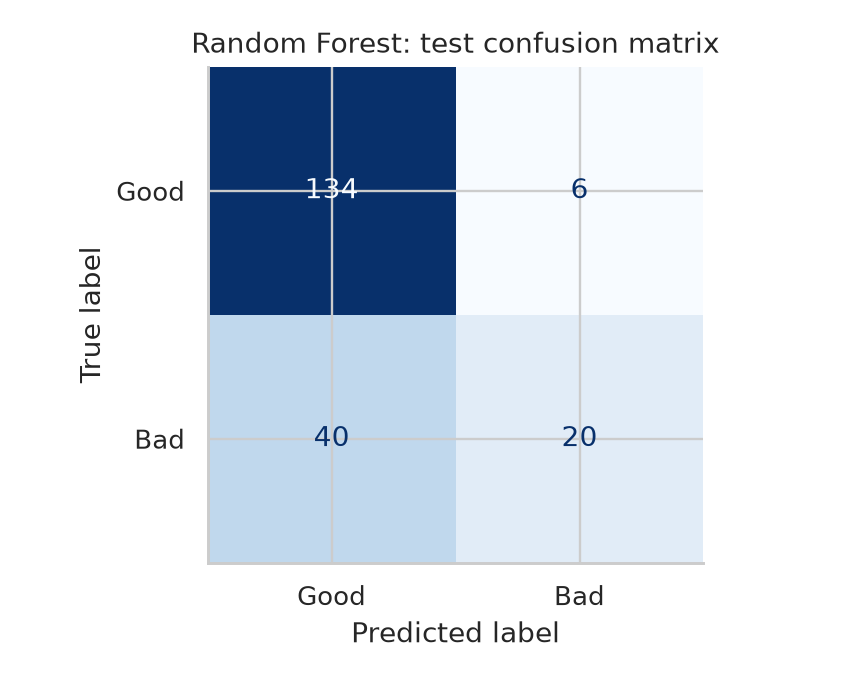
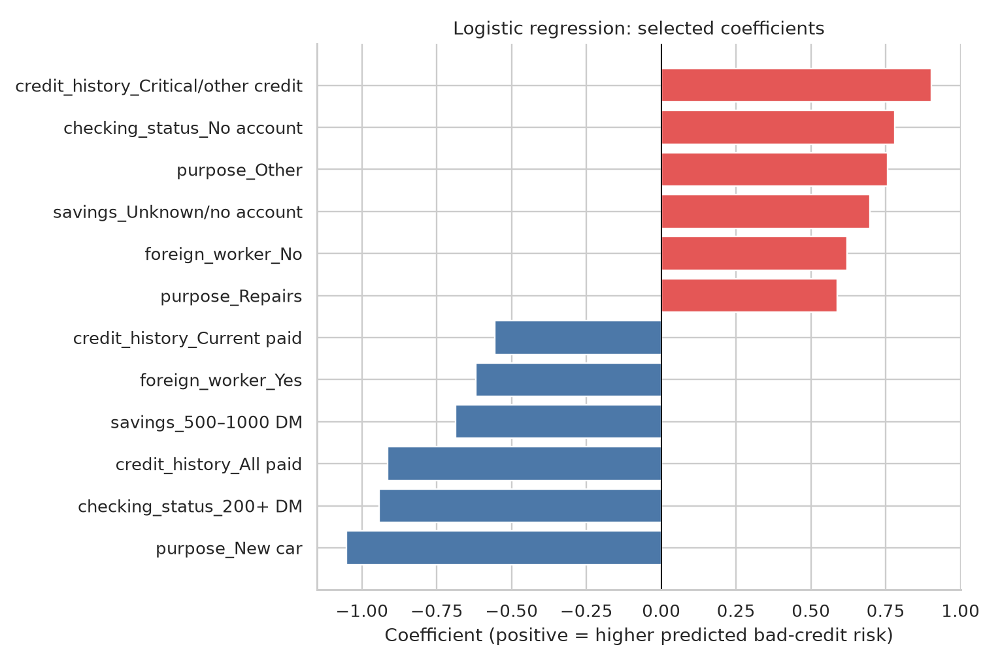

# Credit Risk Analysis

An analysis of 1,000 historical credit records that identifies which recorded factors track with bad outcomes, then compares three classifiers as a held-out benchmark.

`Python` · `pandas` · `scikit-learn` · `Matplotlib` · `Seaborn` · `Jupyter`

---

## Problem

Credit records contain applicant and loan attributes collected before a decision, plus the eventual outcome of the contract. A useful analysis answers two questions: which attributes are associated with a bad outcome, and how well a simple model can rank bad outcomes above good ones.

This repository is a case study on a small historical sample (1973–1975). It produces descriptive findings and a benchmark comparison, not a decision system ready for lending use.

## Dataset

Source: [UCI South German Credit](https://archive.ics.uci.edu/dataset/573/south+german+credit+update), [CC BY 4.0](https://creativecommons.org/licenses/by/4.0/). The raw data and code table are committed under `data/raw/`.

| Property | Value |
| --- | --- |
| Records | 1,000 |
| Columns | 21 (20 predictors + outcome) |
| Continuous fields | `duration_months`, `credit_amount_dm`, `age_years` |
| Coded categorical fields | 17 |
| Outcome balance | 700 good / 300 bad |
| Bad-outcome rate | 30% |
| Period | 1973–1975 |

Selected predictors include `checking_status`, `duration_months`, `credit_history`, `credit_amount_dm`, `savings`, and `age_years`. For evaluation, bad credit is the positive class (`bad_credit = 1`).

Two properties of the source shape the interpretation: bad credits were deliberately oversampled, so 30% is not a population rate, and the credit amounts were transformed in the original data with an unpublished method. The data contain no income field.

## Workflow



## Data Preparation

- Coded category values are checked against `codetable.txt` before any mapping, and unexpected codes raise an error rather than passing through silently.
- Fields are renamed to readable names and category codes are converted to labels. No rows are removed.
- Outliers are intentionally kept; large loans and long durations are plausible and could carry information.
- The 20 predictors are used as-is, and the target is separated out.
- An 80/20 stratified split keeps the class ratio in both sets.
- Median imputation, most-frequent imputation, one-hot encoding, and scaling are fitted inside the model pipeline, so preprocessing never sees the test data.

## Exploratory Analysis

Outcome balance:



300 of 1,000 contracts ended badly. With a 70/30 split, accuracy alone is an unreliable measure and the analysis leans on ROC-AUC, recall, and precision.

Risk by checking-account status:


Checking status separates outcomes more than any other single field. Records with no checking account had the highest bad rate (49.3%); accounts at 200+ DM had the lowest (11.7%).

Risk by credit amount:


The top amount quartile had a 42.0% bad rate, noticeably above the other three. These are associations in the sample, not causal effects.

## Modeling and Evaluation

Three classifiers were trained with simple settings and evaluated once on a held-out set of 200 records, 60 of which are bad outcomes. The decision threshold is 0.5.

| Model | Accuracy | Precision | Recall | F1 | ROC-AUC |
| --- | ---: | ---: | ---: | ---: | ---: |
| Random Forest | 0.770 | 0.769 | 0.333 | 0.465 | 0.755 |
| Logistic Regression | 0.740 | 0.591 | 0.433 | 0.500 | 0.742 |
| Decision Tree | 0.735 | 0.640 | 0.267 | 0.376 | 0.689 |

Random Forest ranks best by ROC-AUC but at the 0.5 threshold it catches only 20 of the 60 bad outcomes, which is a low recall. Logistic Regression catches more (highest recall and F1) at the cost of precision. The trade-off matters because a false positive triggers an unnecessary review, while a false negative lets a bad outcome through.




## Explainability

Interpretation uses the logistic regression coefficients. Positive coefficients raise predicted risk, negative coefficients lower it, and the values are conditional on the other features after encoding and scaling.



The largest effects come from checking status (no account and below 0 DM increase risk, 200+ DM decreases it), longer duration, and several credit-history categories. Correlated features share weight, so these coefficients describe direction and relative size rather than isolated effects. No SHAP or other model-agnostic method is used in this project.

## Key Findings

- Checking balances below 0 DM had a 39.0% bad rate versus 11.7% for balances at 200+ DM.
- Contracts longer than 24 months had a 44.3% bad rate versus 25.7% for shorter contracts.
- Above-median credit amounts had a 32.2% bad rate versus 27.8% for the lower half.
- The highest credit-amount quartile reached a 42.0% bad rate.
- The 30% bad rate reflects deliberate oversampling and should not be read as a current rate.

## Project Structure

```text
credit-risk-analysis/
├── notebooks/
│   └── credit_risk_analysis.ipynb   # Cleaning, EDA, modeling, evaluation
├── data/raw/
│   ├── SouthGermanCredit.asc        # Source data
│   └── codetable.txt                # Category definitions
├── images/                          # Charts written by the notebook
├── portfolio/                       # Three summary figures
├── requirements.txt
└── README.md
```

## How to Run

```bash
git clone https://github.com/abosameh522/credit-risk-analysis.git
cd credit-risk-analysis
python -m venv .venv
source .venv/bin/activate          # Windows: .venv\Scripts\activate
python -m pip install -r requirements.txt
```

The notebook resolves paths relative to its own folder, so run it from `notebooks/`:

```bash
cd notebooks
jupyter nbconvert --to notebook --execute --inplace credit_risk_analysis.ipynb
```

Execution reads `../data/raw/SouthGermanCredit.asc` and writes charts to `../images/` and summary figures to `../portfolio/`.

## Technical Decisions

- **Code table as the source of truth.** Category codes are validated against `codetable.txt` before mapping, so a schema change fails loudly.
- **No automated outlier removal.** Credit amount and duration distributions are skewed, but large values are plausible loans.
- **Preprocessing inside the pipeline.** Imputation, encoding, and scaling are fitted per model on training data only, which prevents test leakage.
- **Stratified split.** Keeps the 70/30 good/bad balance in both partitions.
- **One test set, simple settings.** The goal is a transparent comparison, not tuned results; the same held-out set is reported for all three models.

## Limitations

- The sample is small, old, and deliberately oversampled; results are not representative of a current population.
- There is no income variable, and the amount transformation in the source is undocumented.
- Metrics come from a single split, and the model ranking is taken from that same test set rather than a separate validation set.
- Category rates and coefficients are associations. Correlated features make individual coefficients hard to read in isolation.
- No calibration or fairness analysis is included.

## Future Improvements

- Add cross-validation and choose models on a validation set before the final test.
- Tune the decision threshold on validation data to trade recall against precision.
- Add probability calibration and a fairness check by group.
- Compare against a gradient-boosting model.
- Export a small metrics file so results are versioned alongside the notebook.

## Author

[Ahmed Sameh](https://github.com/abosameh522)
